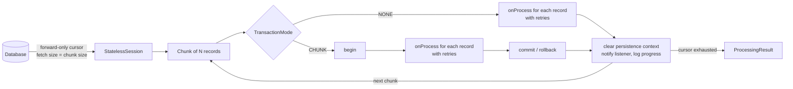

# Quarkus Batch Processor

[](https://github.com/Jean8791/quarkus-batch-processor/actions/workflows/build.yml)
[](https://jitpack.io/#Jean8791/quarkus-batch-processor)


[](LICENSE)

Process millions of database rows in a Quarkus application without running out of memory.

`quarkus-batch-processor` reads records through a forward-only cursor on a Hibernate `StatelessSession`, groups them into chunks and hands them to your code one at a time, with per-chunk transactions, retries and error strategies. It also exports query results to **CSV** or **XLSX** in streaming mode.

> 🇧🇷 [Leia em português](README.pt-BR.md)

```java
@Inject
FastRecordProcessor processor;

ProcessingResult result = processor.source(Invoice.class)
        .query("select i from Invoice i where i.status = :status order by i.id")
        .params(Map.of("status", Status.OPEN))
        .chunkSize(500)
        .transactionMode(TransactionMode.CHUNK)
        .retryStrategy(RetryStrategy.fixedDelay(3, 200, OptimisticLockException.class))
        .onError(ErrorStrategy.CONTINUE_ON_ERROR)
        .onRecordError((invoice, error) -> log.warnf("Invoice %d failed: %s", invoice.getId(), error.getMessage()))
        .onProcess(invoiceService::recalculate)
        .run();
```

## Why

The usual `getResultList()` loads the whole result into memory, and every entity it returns stays in the persistence context until the transaction ends. On large tables this means:

- heap growing with the size of the table, up to an `OutOfMemoryError`;
- dirty checking getting slower with every entity loaded;
- a single long transaction holding locks and undo space for minutes.

This library keeps **one chunk in memory at a time**, clears the persistence context after each chunk and, when asked, commits **one transaction per chunk**.

## Features

- Streaming reads with `ScrollableResults` (`FORWARD_ONLY`) on a `StatelessSession`
- HQL/JPQL queries or native SQL with a `RowMapper`, both with named parameters
- Configurable chunk size, also used as the JDBC fetch size
- `TransactionMode.CHUNK`: a JTA transaction per chunk, rolled back if the chunk fails
- Retries with a fixed delay, limited to the exception types you choose
- `FAIL_FAST` or `CONTINUE_ON_ERROR`, with a callback for each failed record
- Progress logs and a final summary with counts, duration and throughput
- CSV and XLSX export with Apache POI streaming workbooks
- Plain CDI bean: no extension, no configuration properties

## Installation

The library is published on [JitPack](https://jitpack.io/#Jean8791/quarkus-batch-processor).

**Maven**

```xml
<repositories>
    <repository>
        <id>jitpack.io</id>
        <url>https://jitpack.io</url>
    </repository>
</repositories>

<dependency>
    <groupId>com.github.Jean8791</groupId>
    <artifactId>quarkus-batch-processor</artifactId>
    <version>v0.1.0</version>
</dependency>
```

**Gradle**

```groovy
repositories {
    maven { url 'https://jitpack.io' }
}

dependencies {
    implementation 'com.github.Jean8791:quarkus-batch-processor:v0.1.0'
}
```

Your application must already use `quarkus-hibernate-orm` and a JDBC driver. The jar ships a Jandex index, so `FastRecordProcessor` is discovered as a bean without `quarkus.index-dependency`.

For **XLSX** export, also add Apache POI (it is an optional dependency):

```xml
<dependency>
    <groupId>org.apache.poi</groupId>
    <artifactId>poi-ooxml</artifactId>
    <version>5.4.1</version>
</dependency>
```

## How it works



1. A `StatelessSession` opens a forward-only cursor. Entities read this way are not tracked, so reading does not grow the persistence context.
2. Records are buffered until the chunk is full (or the cursor ends).
3. Each record goes to your `onProcess` consumer. Failures are retried according to the `RetryStrategy`.
4. After the chunk, the application's `EntityManager` is cleared, the `ChunkListener` is notified and progress is logged.
5. When the cursor is exhausted, a `ProcessingResult` is returned.

## Configuration

| Method | Default | Description |
|---|---|---|
| `query(hql)` | `select e from Entity e` | HQL/JPQL query returning the record type |
| `nativeQuery(sql)` | — | Native SQL query; requires `rowMapper` |
| `rowMapper(mapper)` | — | Converts each native row (`Object[]`) into a record |
| `params(map)` | empty | Named parameters for the query |
| `chunkSize(n)` | `1000` | Records per chunk and JDBC fetch size |
| `transactionMode(mode)` | `NONE` | `NONE` or `CHUNK` (one JTA transaction per chunk) |
| `onProcess(consumer)` | **required** | Work done for each record |
| `retryStrategy(strategy)` | `noRetry()` | Attempts per record and retryable exception types |
| `onError(strategy)` | `FAIL_FAST` | `FAIL_FAST` or `CONTINUE_ON_ERROR` |
| `onRecordError(handler)` | — | Called for each record that failed after all retries |
| `onChunkComplete(listener)` | — | Called after each chunk with the processed count |
| `loggingEnabled(flag)` | `true` | Start, progress and finish log lines |
| `progressLogEveryChunks(n)` | `1` | Log progress every N chunks |
| `processorName(name)` | `<Entity>Processor` | Name shown in the logs |

### Transactions

- **`NONE`**: the processor opens no transactions. Use it for read-only work, such as exports, or when the consumer manages its own transactions.
- **`CHUNK`**: each chunk runs in its own transaction. If a record fails under `FAIL_FAST`, the chunk is rolled back and the run stops; chunks committed before stay committed. `run()` must be called **outside** of a transaction (not from a `@Transactional` method), otherwise it throws `IllegalStateException` instead of committing the caller's transaction.

### Errors and retries

```java
processor.source(Customer.class)
        .retryStrategy(RetryStrategy.fixedDelay(3, 500, PessimisticLockException.class))
        .onError(ErrorStrategy.CONTINUE_ON_ERROR)
        .onRecordError((customer, error) -> failures.add(customer.getId()))
        .onProcess(customerService::syncWithCrm)
        .run();
```

`fixedDelay(3, 500, ...)` means up to three attempts, 500 ms apart, only for the listed exception types and their subclasses. Any other exception fails the record at once.

### Native queries

```java
processor.source(CustomerRow.class)
        .nativeQuery("select c.id, c.name, c.email from customers c where c.status = :status order by c.id")
        .params(Map.of("status", "ACTIVE"))
        .rowMapper(row -> new CustomerRow(((Number) row[0]).longValue(), (String) row[1], (String) row[2]))
        .onProcess(newsletter::send)
        .run();
```

## Exporting reports

`ProcessorBackedReportService` reads an HQL query in chunks and writes each record as a row.

```java
ReportDefinition definition = new ReportDefinition("Customers", "Customers", List.of(
        new ReportColumn("id", "ID", ColumnType.LONG, 10),
        new ReportColumn("name", "Name", ColumnType.STRING, 40),
        new ReportColumn("balance", "Balance", ColumnType.DECIMAL, 15)));

ReportResult result = new ProcessorBackedReportService(processor).generate(
        Customer.class,
        "select c from Customer c order by c.id",
        1000,
        new ReportRequest("customers", ReportFormat.XLSX, definition, new LocalFileTarget("/var/reports")),
        c -> List.of(c.getId(), c.getName(), c.getBalance()));

// result.filePath() -> /var/reports/customers.xlsx, result.rowCount() -> rows written
```

- **CSV**: UTF-8, values with commas, quotes or line breaks are quoted.
- **XLSX**: POI `SXSSFWorkbook` keeps only 100 rows in memory; numbers and booleans become typed cells.
- `LocalFileTarget` rejects file names that leave its base folder, such as `../other.csv`. Implement `ReportOutputTarget` to write to S3 or any other destination.

## Logging

```
FastRecord started | processor=InvoiceRecalc | entity=Invoice | chunkSize=500 | hql=select i from Invoice i ...
FastRecord chunk completed | processor=InvoiceRecalc | entity=Invoice | processed=500 | totalRead=500
...
FastRecord finished | processor=InvoiceRecalc | entity=Invoice | processed=182340 | errors=3 | retries=11 | totalRead=182343 | durationMs=48210 | throughput=3782.27 records/s
```

## Things to know

- **Detached records.** Entities read by a `StatelessSession` are not managed, and lazy associations cannot be loaded from them. Use `join fetch` in the query for the associations you need, or load what you want to change through your own `EntityManager` inside the consumer.
- **PostgreSQL cursors.** The PostgreSQL JDBC driver only streams rows with a fetch size when autocommit is off. Outside of a transaction, Quarkus hands out connections in autocommit mode, so the driver may fetch the whole result at once. For very large tables on PostgreSQL, call `run()` with `TransactionMode.NONE` from inside a transaction.
- **Persistence context.** The application's `EntityManager` is cleared after every chunk, so do not keep managed entities across chunks.
- **One run, one thread.** A `Processor` is configured and run once, on the calling thread.

## Requirements

- Java 17+
- Quarkus 3.x with `quarkus-hibernate-orm`
- Apache POI 5.x, only for XLSX export

## Building from source

```bash
./mvnw verify
```

This runs the unit tests and builds the jar, the sources jar and the Javadoc jar.

## Roadmap

- Parallel processing of chunks
- Keyset pagination as an alternative to cursors
- Micrometer metrics
- Exponential backoff for retries

## License

[MIT](LICENSE) © Jean Moraes
