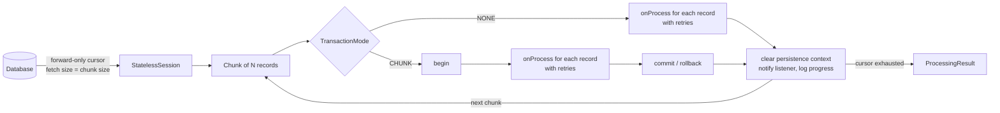

# Quarkus Batch Processor

[](https://github.com/Jean8791/quarkus-batch-processor/actions/workflows/build.yml)
[](https://jitpack.io/#Jean8791/quarkus-batch-processor)


[](LICENSE)

Process millions of database rows in a Quarkus application without running out of memory.

`quarkus-batch-processor` reads records through a forward-only cursor on a Hibernate `StatelessSession`, groups them into chunks and hands them to your code one at a time, with per-chunk transactions, retries and error strategies. It also exports query results to **CSV** or **XLSX** in streaming mode.

> 🇧🇷 [Leia em português](README.pt-BR.md)

```java
@Inject
FastRecordProcessor processor;

ProcessingResult result = processor.source(Invoice.class)
        .query("select i from Invoice i where i.status = :status order by i.id")
        .params(Map.of("status", Status.OPEN))
        .chunkSize(500)
        .transactionMode(TransactionMode.CHUNK)
        .retryStrategy(RetryStrategy.fixedDelay(3, 200, OptimisticLockException.class))
        .onError(ErrorStrategy.CONTINUE_ON_ERROR)
        .onRecordError((invoice, error) -> log.warnf("Invoice %d failed: %s", invoice.getId(), error.getMessage()))
        .onProcess(invoiceService::recalculate)
        .run();
```

## Why

The usual `getResultList()` loads the whole result into memory, and every entity it returns stays in the persistence context until the transaction ends. On large tables this means:

- heap growing with the size of the table, up to an `OutOfMemoryError`;
- dirty checking getting slower with every entity loaded;
- a single long transaction holding locks and undo space for minutes.

This library keeps **one chunk in memory at a time**, clears the persistence context after each chunk and, when asked, commits **one transaction per chunk**.

## Features

- Streaming reads with `ScrollableResults` (`FORWARD_ONLY`) on a `StatelessSession`
- HQL/JPQL queries or native SQL with a `RowMapper`, both with named parameters
- Configurable chunk size, also used as the JDBC fetch size
- `TransactionMode.CHUNK`: a JTA transaction per chunk, rolled back if the chunk fails
- Retries with a fixed delay, limited to the exception types you choose
- `FAIL_FAST` or `CONTINUE_ON_ERROR`, with a callback for each failed record
- Progress logs and a final summary with counts, duration and throughput
- CSV and XLSX export with Apache POI streaming workbooks
- Plain CDI bean: no extension, no configuration properties

## Installation

The library is published on [JitPack](https://jitpack.io/#Jean8791/quarkus-batch-processor).

**Maven**

```xml
<repositories>
    <repository>
        <id>jitpack.io</id>
        <url>https://jitpack.io</url>
    </repository>
</repositories>

<dependency>
    <groupId>com.github.Jean8791</groupId>
    <artifactId>quarkus-batch-processor</artifactId>
    <version>v0.1.0</version>
</dependency>
```

**Gradle**

```groovy
repositories {
    maven { url 'https://jitpack.io' }
}

dependencies {
    implementation 'com.github.Jean8791:quarkus-batch-processor:v0.1.0'
}
```

Your application must already use `quarkus-hibernate-orm` and a JDBC driver. The jar ships a Jandex index, so `FastRecordProcessor` is discovered as a bean without `quarkus.index-dependency`.

For **XLSX** export, also add Apache POI (it is an optional dependency):

```xml
<dependency>
    <groupId>org.apache.poi</groupId>
    <artifactId>poi-ooxml</artifactId>
    <version>5.4.1</version>
</dependency>
```

## How it works



1. A `StatelessSession` opens a forward-only cursor. Entities read this way are not tracked, so reading does not grow the persistence context.
2. Records are buffered until the chunk is full (or the cursor ends).
3. Each record goes to your `onProcess` consumer. Failures are retried according to the `RetryStrategy`.
4. After the chunk, the application's `EntityManager` is cleared, the `ChunkListener` is notified and progress is logged.
5. When the cursor is exhausted, a `ProcessingResult` is returned.

## Configuration

| Method | Default | Description |
|---|---|---|
| `query(hql)` | `select e from Entity e` | HQL/JPQL query returning the record type |
| `nativeQuery(sql)` | — | Native SQL query; requires `rowMapper` |
| `rowMapper(mapper)` | — | Converts each native row (`Object[]`) into a record |
| `params(map)` | empty | Named parameters for the query |
| `chunkSize(n)` | `1000` | Records per chunk and JDBC fetch size |
| `transactionMode(mode)` | `NONE` | `NONE` or `CHUNK` (one JTA transaction per chunk) |
| `onProcess(consumer)` | **required** | Work done for each record |
| `retryStrategy(strategy)` | `noRetry()` | Attempts per record and retryable exception types |
| `onError(strategy)` | `FAIL_FAST` | `FAIL_FAST` or `CONTINUE_ON_ERROR` |
| `onRecordError(handler)` | — | Called for each record that failed after all retries |
| `onChunkComplete(listener)` | — | Called after each chunk with the processed count |
| `loggingEnabled(flag)` | `true` | Start, progress and finish log lines |
| `progressLogEveryChunks(n)` | `1` | Log progress every N chunks |
| `processorName(name)` | `<Entity>Processor` | Name shown in the logs |

### Transactions

- **`NONE`**: the processor opens no transactions. Use it for read-only work, such as exports, or when the consumer manages its own transactions.
- **`CHUNK`**: each chunk runs in its own transaction. If a record fails under `FAIL_FAST`, the chunk is rolled back and the run stops; chunks committed before stay committed. `run()` must be called **outside** of a transaction (not from a `@Transactional` method), otherwise it throws `IllegalStateException` instead of committing the caller's transaction.

### Errors and retries

```java
processor.source(Customer.class)
        .retryStrategy(RetryStrategy.fixedDelay(3, 500, PessimisticLockException.class))
        .onError(ErrorStrategy.CONTINUE_ON_ERROR)
        .onRecordError((customer, error) -> failures.add(customer.getId()))
        .onProcess(customerService::syncWithCrm)
        .run();
```

`fixedDelay(3, 500, ...)` means up to three attempts, 500 ms apart, only for the listed exception types and their subclasses. Any other exception fails the record at once.

### Native queries

```java
processor.source(CustomerRow.class)
        .nativeQuery("select c.id, c.name, c.email from customers c where c.status = :status order by c.id")
        .params(Map.of("status", "ACTIVE"))
        .rowMapper(row -> new CustomerRow(((Number) row[0]).longValue(), (String) row[1], (String) row[2]))
        .onProcess(newsletter::send)
        .run();
```

## Exporting reports

`ProcessorBackedReportService` reads an HQL query in chunks and writes each record as a row.

```java
ReportDefinition definition = new ReportDefinition("Customers", "Customers", List.of(
        new ReportColumn("id", "ID", ColumnType.LONG, 10),
        new ReportColumn("name", "Name", ColumnType.STRING, 40),
        new ReportColumn("balance", "Balance", ColumnType.DECIMAL, 15)));

ReportResult result = new ProcessorBackedReportService(processor).generate(
        Customer.class,
        "select c from Customer c order by c.id",
        1000,
        new ReportRequest("customers", ReportFormat.XLSX, definition, new LocalFileTarget("/var/reports")),
        c -> List.of(c.getId(), c.getName(), c.getBalance()));

// result.filePath() -> /var/reports/customers.xlsx, result.rowCount() -> rows written
```

- **CSV**: UTF-8, values with commas, quotes or line breaks are quoted.
- **XLSX**: POI `SXSSFWorkbook` keeps only 100 rows in memory; numbers and booleans become typed cells.
- `LocalFileTarget` rejects file names that leave its base folder, such as `../other.csv`. Implement `ReportOutputTarget` to write to S3 or any other destination.

## Logging

```
FastRecord started | processor=InvoiceRecalc | entity=Invoice | chunkSize=500 | hql=select i from Invoice i ...
FastRecord chunk completed | processor=InvoiceRecalc | entity=Invoice | processed=500 | totalRead=500
...
FastRecord finished | processor=InvoiceRecalc | entity=Invoice | processed=182340 | errors=3 | retries=11 | totalRead=182343 | durationMs=48210 | throughput=3782.27 records/s
```

## Things to know

- **Detached records.** Entities read by a `StatelessSession` are not managed, and lazy associations cannot be loaded from them. Use `join fetch` in the query for the associations you need, or load what you want to change through your own `EntityManager` inside the consumer.
- **PostgreSQL cursors.** The PostgreSQL JDBC driver only streams rows with a fetch size when autocommit is off. Outside of a transaction, Quarkus hands out connections in autocommit mode, so the driver may fetch the whole result at once. For very large tables on PostgreSQL, call `run()` with `TransactionMode.NONE` from inside a transaction.
- **Persistence context.** The application's `EntityManager` is cleared after every chunk, so do not keep managed entities across chunks.
- **One run, one thread.** A `Processor` is configured and run once, on the calling thread.

## Benchmark

Does the library really keep one chunk in memory? Short answer: **yes, but only when `run()` is called inside a transaction on PostgreSQL**. Without one, the PostgreSQL driver loads the whole result set, and memory grows with the table (see [Known limits](#known-limits)).

### Methodology

- Same table (`bench_row`, 5 columns, one of them a 96-character string), same HQL query and same per-row work for every variant. Real PostgreSQL in a container, no mocks.
- **Read**: sum one numeric column. **XLSX export**: write 5 columns per row to a file.
- Variants:
  - *Naive*: `createQuery(...).getResultList()` in a transaction, then iterate. The XLSX variant writes an in-memory `XSSFWorkbook`.
  - *Library (default)*: `FastRecordProcessor` with `TransactionMode.NONE`, called outside a transaction. The XLSX variant uses `ProcessorBackedReportService`.
  - *Library inside a transaction*: the same call made from inside a transaction, as described in [Things to know](#things-to-know).
  - `TransactionMode.CHUNK` was also measured for reads, see `benchmark/results/`.
- Chunk size 1000. Each case runs in a **new JVM** with a fixed `-Xmx`. Inside it, a warm-up pass of 20,000 rows runs first, then a GC, then the measured pass.
- 5 repetitions per case. **Repetition 1 is discarded**, and the table shows the **median of the other 4**.
- **Time** covers the measured pass only (not Quarkus startup). **Memory** is the peak heap occupancy right after a garbage collection, which is what stayed alive. The heap in use before the pass was 11 to 19 MB.
- Time of runs that ended in `OutOfMemoryError` is not reported: it measures the garbage collector struggling, not the work.

### Environment

| | |
|---|---|
| CPU | Intel Core i7-12650H, 16 logical cores |
| RAM | 31 GB |
| OS | Linux 7.0.0-43-generic |
| JVM | OpenJDK 17.0.9, G1 (default), no other flags |
| PostgreSQL | 16.15 (`postgres:16-alpine`, default settings, same host) |
| Library | 0.1.0 |
| `-Xmx` | 256m and 512m |

Full details are in [`benchmark/results/environment.txt`](benchmark/results/environment.txt).

### Results

Each cell is median time / peak memory kept after GC. `OOM (4/4)` means `OutOfMemoryError` in all 4 counted runs.

**Read**

| Rows | `-Xmx` | Naive | Library (default) | Library inside a transaction |
|---|---|---|---|---|
| 100,000 | 256m | 327 ms / 107 MB | 239 ms / 43 MB | 280 ms / 12 MB |
| 100,000 | 512m | 306 ms / 99 MB | 247 ms / 43 MB | 290 ms / 12 MB |
| 1,000,000 | 256m | OOM (4/4) | OOM (4/4) | 1,976 ms / 12 MB |
| 1,000,000 | 512m | OOM (4/4) | 1,608 ms / 329 MB | 1,993 ms / 12 MB |

**XLSX export**

| Rows | `-Xmx` | Naive | Library (default) | Library inside a transaction |
|---|---|---|---|---|
| 100,000 | 256m | OOM (4/4) | 1,470 ms / 50 MB | 1,535 ms / 20 MB |
| 100,000 | 512m | OOM (3/4), 1 run without a result | 1,462 ms / 51 MB | 1,547 ms / 21 MB |
| 1,000,000 | 256m | OOM (4/4) | OOM (4/4) | 14,891 ms / 20 MB |
| 1,000,000 | 512m | OOM (4/4) | 13,360 ms / 333 MB | 14,880 ms / 20 MB |

The CSV files behind these tables are in [`benchmark/results/`](benchmark/results/): `results.csv` (every run) and `summary.csv` (medians).

### Known limits

- **Default usage does not stream on PostgreSQL.** Called outside a transaction, the library kept 329 MB at 1 million rows (versus 43 MB at 100,000), so memory grows with the table, and it ran out of memory with 256m. `TransactionMode.CHUNK` behaves the same way (read results in `results.csv`). In a manual diagnostic run (one run, `-Xmx1g`, not part of the CSV), a heap histogram showed 1,000,000 live `org.postgresql.core.Tuple` objects, which matches the driver buffering the result. Call `run()` or the report service from inside a transaction to get the constant ~12 MB shown above.
- **Streaming costs time.** Inside a transaction, 1 million rows took 1,993 ms against 1,608 ms without one (reading from a cursor in batches of 1000). The same happens in the XLSX export (14,880 ms against 13,360 ms).
- **Small tables.** At 100,000 rows the library was not slower than the naive version in this setup. Sizes below 100,000 rows were not measured.
- The naive XLSX export runs out of memory at 100,000 rows even with 512m. Part of that is Apache POI's in-memory workbook, not only the list of entities. The two were not measured separately.
- One XLSX naive run (100,000 rows, 512m) ended without writing a result. It is counted as a failure, not as an OOM, because the cause was not confirmed.
- Not measured: 5 million rows, heaps above 512m (so the exact size where the naive version fails is only known to be between 100,000 and 1,000,000 rows at 512m), other chunk sizes, other garbage collectors, other databases, and a hand-written cursor loop without the library.
- Numbers come from one laptop with the database in a container on the same machine and other programs running. Use them for the order of magnitude, not as a guarantee.

### How to reproduce

Needs Docker, Java 17 and Python 3.

```bash
./benchmark/run.sh             # 100k and 1M rows, 256m and 512m, 5 repetitions (slow)
./benchmark/run.sh --with-5m   # also 5M rows in the read scenario (slow)
./benchmark/run.sh --quick     # smoke test, output not meant to be committed
```

The script installs the library into your local Maven repository, starts a throwaway PostgreSQL container with a random password kept in a temporary file, and writes `benchmark/results/results.csv`, `summary.csv` and `environment.txt`. The benchmark lives in its own Maven project and is not part of the published artifact.

## Requirements

- Java 17+
- Quarkus 3.x with `quarkus-hibernate-orm`
- Apache POI 5.x, only for XLSX export

## Building from source

```bash
./mvnw verify
```

This runs the unit tests and builds the jar, the sources jar and the Javadoc jar.

## Roadmap

- Parallel processing of chunks
- Keyset pagination as an alternative to cursors
- Micrometer metrics
- Exponential backoff for retries

## License

[MIT](LICENSE) © Jean Moraes
