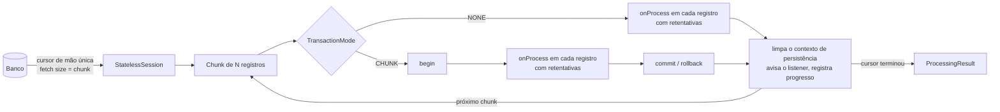

# Quarkus Batch Processor

[](https://github.com/Jean8791/quarkus-batch-processor/actions/workflows/build.yml)
[](https://jitpack.io/#Jean8791/quarkus-batch-processor)


[](LICENSE)

Processe milhões de linhas do banco numa aplicação Quarkus sem estourar a memória.

O `quarkus-batch-processor` lê os registros por um cursor de mão única numa `StatelessSession` do Hibernate, agrupa em chunks e entrega um por vez ao seu código, com transação por chunk, retentativas e estratégias de erro. Também exporta o resultado de consultas para **CSV** ou **XLSX** em streaming.

> 🇺🇸 [Read in English](README.md)

```java
@Inject
FastRecordProcessor processor;

ProcessingResult result = processor.source(Invoice.class)
        .query("select i from Invoice i where i.status = :status order by i.id")
        .params(Map.of("status", Status.OPEN))
        .chunkSize(500)
        .transactionMode(TransactionMode.CHUNK)
        .retryStrategy(RetryStrategy.fixedDelay(3, 200, OptimisticLockException.class))
        .onError(ErrorStrategy.CONTINUE_ON_ERROR)
        .onRecordError((invoice, error) -> log.warnf("Fatura %d falhou: %s", invoice.getId(), error.getMessage()))
        .onProcess(invoiceService::recalculate)
        .run();
```

## Por quê

O `getResultList()` comum carrega o resultado inteiro na memória, e cada entidade devolvida fica no contexto de persistência até a transação acabar. Em tabelas grandes isso significa:

- heap crescendo junto com a tabela, até um `OutOfMemoryError`;
- dirty checking cada vez mais lento a cada entidade carregada;
- uma única transação longa segurando locks e espaço de undo por minutos.

Esta biblioteca mantém **um chunk por vez na memória**, limpa o contexto de persistência depois de cada chunk e, quando pedido, faz **uma transação por chunk**.

## Recursos

- Leitura em streaming com `ScrollableResults` (`FORWARD_ONLY`) numa `StatelessSession`
- Consultas HQL/JPQL ou SQL nativo com `RowMapper`, ambas com parâmetros nomeados
- Tamanho do chunk configurável, usado também como fetch size do JDBC
- `TransactionMode.CHUNK`: uma transação JTA por chunk, desfeita se o chunk falhar
- Retentativas com intervalo fixo, só para os tipos de exceção que você escolher
- `FAIL_FAST` ou `CONTINUE_ON_ERROR`, com callback para cada registro que falhou
- Logs de progresso e resumo final com contagens, duração e vazão
- Exportação para CSV e XLSX com workbooks em streaming do Apache POI
- Bean CDI simples: sem extensão e sem propriedades de configuração

## Instalação

A biblioteca é publicada no [JitPack](https://jitpack.io/#Jean8791/quarkus-batch-processor).

**Maven**

```xml
<repositories>
    <repository>
        <id>jitpack.io</id>
        <url>https://jitpack.io</url>
    </repository>
</repositories>

<dependency>
    <groupId>com.github.Jean8791</groupId>
    <artifactId>quarkus-batch-processor</artifactId>
    <version>v0.1.0</version>
</dependency>
```

**Gradle**

```groovy
repositories {
    maven { url 'https://jitpack.io' }
}

dependencies {
    implementation 'com.github.Jean8791:quarkus-batch-processor:v0.1.0'
}
```

A aplicação precisa já usar `quarkus-hibernate-orm` e um driver JDBC. O jar traz índice Jandex, então o `FastRecordProcessor` é encontrado como bean sem `quarkus.index-dependency`.

Para exportar **XLSX**, adicione também o Apache POI (é uma dependência opcional):

```xml
<dependency>
    <groupId>org.apache.poi</groupId>
    <artifactId>poi-ooxml</artifactId>
    <version>5.4.1</version>
</dependency>
```

## Como funciona



1. Uma `StatelessSession` abre um cursor de mão única. Entidades lidas assim não são rastreadas, então a leitura não faz o contexto de persistência crescer.
2. Os registros são acumulados até o chunk encher (ou o cursor acabar).
3. Cada registro vai para o seu `onProcess`. Falhas são repetidas conforme a `RetryStrategy`.
4. Depois do chunk, o `EntityManager` da aplicação é limpo, o `ChunkListener` é avisado e o progresso vai para o log.
5. Quando o cursor termina, volta um `ProcessingResult`.

## Configuração

| Método | Padrão | Descrição |
|---|---|---|
| `query(hql)` | `select e from Entidade e` | Consulta HQL/JPQL que devolve o tipo do registro |
| `nativeQuery(sql)` | — | Consulta SQL nativa; exige `rowMapper` |
| `rowMapper(mapper)` | — | Converte cada linha nativa (`Object[]`) num registro |
| `params(map)` | vazio | Parâmetros nomeados da consulta |
| `chunkSize(n)` | `1000` | Registros por chunk e fetch size do JDBC |
| `transactionMode(mode)` | `NONE` | `NONE` ou `CHUNK` (uma transação JTA por chunk) |
| `onProcess(consumer)` | **obrigatório** | O que fazer com cada registro |
| `retryStrategy(strategy)` | `noRetry()` | Tentativas por registro e exceções que justificam repetir |
| `onError(strategy)` | `FAIL_FAST` | `FAIL_FAST` ou `CONTINUE_ON_ERROR` |
| `onRecordError(handler)` | — | Chamado para cada registro que falhou depois das retentativas |
| `onChunkComplete(listener)` | — | Chamado depois de cada chunk com o total processado |
| `loggingEnabled(flag)` | `true` | Linhas de log de início, progresso e fim |
| `progressLogEveryChunks(n)` | `1` | Registra o progresso a cada N chunks |
| `processorName(name)` | `<Entidade>Processor` | Nome que aparece no log |

### Transações

- **`NONE`**: o processador não abre transações. Use em trabalho só de leitura, como exportações, ou quando o próprio consumer cuida das transações.
- **`CHUNK`**: cada chunk roda na sua transação. Se um registro falhar em `FAIL_FAST`, o chunk é desfeito e a execução para; os chunks já commitados continuam commitados. O `run()` precisa ser chamado **fora** de uma transação (não dentro de um método `@Transactional`); senão lança `IllegalStateException` em vez de commitar a transação de quem chamou.

### Erros e retentativas

```java
processor.source(Customer.class)
        .retryStrategy(RetryStrategy.fixedDelay(3, 500, PessimisticLockException.class))
        .onError(ErrorStrategy.CONTINUE_ON_ERROR)
        .onRecordError((customer, error) -> failures.add(customer.getId()))
        .onProcess(customerService::syncWithCrm)
        .run();
```

`fixedDelay(3, 500, ...)` quer dizer até três tentativas, com 500 ms entre elas, só para os tipos de exceção listados e suas subclasses. Qualquer outra exceção faz o registro falhar na hora.

### Consultas nativas

```java
processor.source(CustomerRow.class)
        .nativeQuery("select c.id, c.name, c.email from customers c where c.status = :status order by c.id")
        .params(Map.of("status", "ACTIVE"))
        .rowMapper(row -> new CustomerRow(((Number) row[0]).longValue(), (String) row[1], (String) row[2]))
        .onProcess(newsletter::send)
        .run();
```

## Exportando relatórios

O `ProcessorBackedReportService` lê uma consulta HQL em chunks e grava cada registro como uma linha.

```java
ReportDefinition definition = new ReportDefinition("Clientes", "Clientes", List.of(
        new ReportColumn("id", "ID", ColumnType.LONG, 10),
        new ReportColumn("name", "Nome", ColumnType.STRING, 40),
        new ReportColumn("balance", "Saldo", ColumnType.DECIMAL, 15)));

ReportResult result = new ProcessorBackedReportService(processor).generate(
        Customer.class,
        "select c from Customer c order by c.id",
        1000,
        new ReportRequest("clientes", ReportFormat.XLSX, definition, new LocalFileTarget("/var/reports")),
        c -> List.of(c.getId(), c.getName(), c.getBalance()));

// result.filePath() -> /var/reports/clientes.xlsx, result.rowCount() -> linhas gravadas
```

- **CSV**: UTF-8; valores com vírgula, aspas ou quebra de linha vão entre aspas.
- **XLSX**: o `SXSSFWorkbook` do POI mantém só 100 linhas na memória; números e booleanos viram células tipadas.
- O `LocalFileTarget` recusa nomes de arquivo que saem da pasta base, como `../outro.csv`. Implemente `ReportOutputTarget` para gravar no S3 ou em qualquer outro destino.

## Log

```
FastRecord started | processor=InvoiceRecalc | entity=Invoice | chunkSize=500 | hql=select i from Invoice i ...
FastRecord chunk completed | processor=InvoiceRecalc | entity=Invoice | processed=500 | totalRead=500
...
FastRecord finished | processor=InvoiceRecalc | entity=Invoice | processed=182340 | errors=3 | retries=11 | totalRead=182343 | durationMs=48210 | throughput=3782.27 records/s
```

## Bom saber

- **Registros desanexados.** Entidades lidas por uma `StatelessSession` não são gerenciadas, e associações lazy não podem ser carregadas a partir delas. Use `join fetch` na consulta para as associações de que precisar, ou carregue o que for alterar pelo seu próprio `EntityManager` dentro do consumer.
- **Cursores no PostgreSQL.** O driver JDBC do PostgreSQL só faz streaming com fetch size quando o autocommit está desligado. Fora de uma transação, o Quarkus entrega conexões com autocommit, e o driver pode trazer o resultado inteiro de uma vez. Para tabelas muito grandes no PostgreSQL, chame o `run()` com `TransactionMode.NONE` de dentro de uma transação.
- **Contexto de persistência.** O `EntityManager` da aplicação é limpo depois de cada chunk; não guarde entidades gerenciadas de um chunk para outro.
- **Uma execução, uma thread.** Um `Processor` é configurado e executado uma vez, na thread que o chamou.

## Requisitos

- Java 17+
- Quarkus 3.x com `quarkus-hibernate-orm`
- Apache POI 5.x, só para exportar XLSX

## Compilando

```bash
./mvnw verify
```

Roda os testes unitários e gera o jar, o jar de fontes e o jar de Javadoc.

## Próximos passos

- Processamento de chunks em paralelo
- Paginação por keyset como alternativa aos cursores
- Métricas com Micrometer
- Backoff exponencial nas retentativas

## Licença

[MIT](LICENSE) © Jean Moraes
